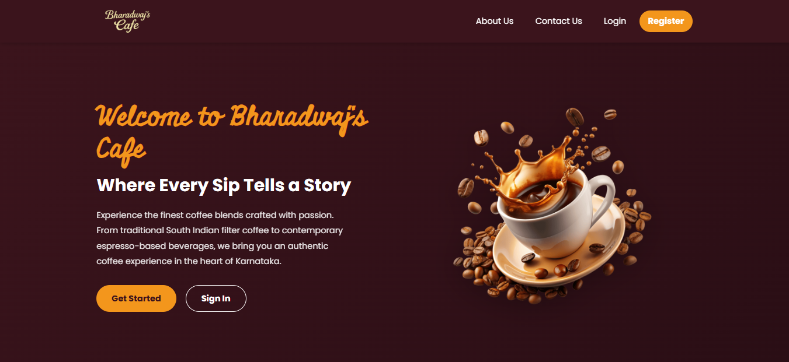
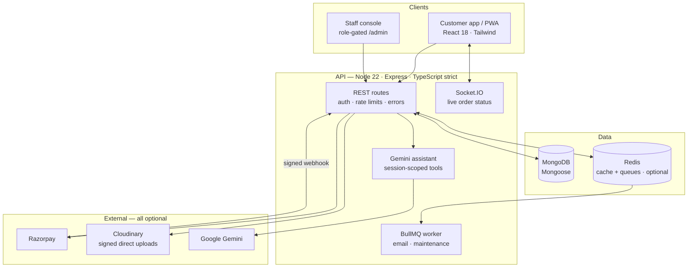
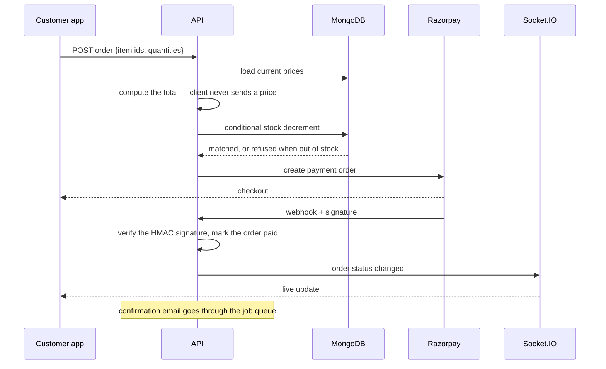

# Bharadwaj's Cafe

<p align="center">
  <a href="Demo.mp4">
    
  </a>
  <br>
  <sub>▶ <b><a href="Demo.mp4">Watch the demo</a></b> (74 s): design records, commit history, tests and the live app</sub>
</p>

**A full-stack ordering and payments platform for a speciality coffee house — where the server is the only authority on price.**

[](https://github.com/guru-bharadwaj20/Bharadwaj-Cafe/actions/workflows/ci.yml)
[](backend/package.json)
[](backend/tsconfig.json)
[](frontend/package.json)
[](frontend/src/tailwind.css)
[](backend/tests)
[](LICENSE)

Customers browse a menu and merchandise catalogue, place orders, collect loyalty
points and ask a Gemini-backed assistant for help. Staff get a separate,
role-gated console with a live dashboard and analytics. Every integration beyond
MongoDB is optional, and the app tells you at startup which ones it found.

<p align="center">
  
</p>

---

## Contents

| Section | |
|---|---|
| [What it does](#what-it-does) | The feature surface, by area |
| [Architecture](#architecture) | Two front ends, one API |
| [How an order travels](#how-an-order-travels) | Cart, price, pay, track |
| [Quick start](#quick-start) | Docker in one command, or run it by hand |
| [Project status](#project-status) | What ships, and what CI proves |
| [Design decisions](#design-decisions) | The tradeoffs, and why |
| [Repository layout](#repository-layout) | Where things live |
| [Documentation](#documentation) | Which file answers which question |
| [Team](#team) | Who built it |

---

## What it does

| Area | Capabilities |
|---|---|
| **Catalogue** | Menu and merchandise browsing with search and dietary filters, reviews, a wishlist |
| **Checkout** | Cart, saved delivery addresses, online payment via Razorpay or pay on collection |
| **Payments** | Order totals computed server-side, signature-verified Razorpay webhooks |
| **Inventory** | Race-safe stock decrements with conditional updates, no oversell under concurrency |
| **Tracking** | Live order status over Socket.IO, with optional push notifications |
| **Loyalty** | Points earned on orders and redeemable for rewards |
| **Assistant** | Google Gemini (`gemini-2.5-flash`) with function calling, its tools bound to the signed-in session |
| **Staff console** | `/admin`, gated on role: orders, users, menu, and analytics — revenue, best sellers, peak hours |
| **Background jobs** | BullMQ queues for email and maintenance, with retries and backoff; inline when Redis is absent |
| **PWA** | Installable, and usable offline for browsing |

---

## Architecture

Customer and staff are two separate front-end applications over one API. Redis,
Cloudinary, Gemini, Razorpay and Google sign-in are each optional; MongoDB and a
JWT secret are the only hard requirements.



---

## How an order travels



A tampered cart cannot change what is charged, and two customers buying the last
item cannot both succeed.

---

## Quick start

> Deploying it? [SETUP.md](SETUP.md) and [docs/DEPLOYMENT.md](docs/DEPLOYMENT.md)
> cover external services, Vercel and Render. This is only the local shape.

```bash
# 1 — everything in containers; Compose ships working defaults, no .env needed
docker compose up --build            # web :8080 · API :5000
```

Or run it by hand:

```bash
# 1 — API (MongoDB and JWT_SECRET are the only hard requirements)
cd backend && npm install
cp .env.example .env
npm run seed                         # menu + merchandise
npm run dev                          # :5000

# 2 — web app
cd ../frontend && npm install
npm run dev                          # :5173

# 3 — useful scripts
npm test                             # backend 238 · frontend 41
npm run create-admin                 # staff account from ADMIN_* in .env
npm run upload-assets                # push images to Cloudinary, regenerate the manifest
```

| Variable | Without it |
|---|---|
| `MONGO_URI` | **Required.** Nothing runs |
| `JWT_SECRET` | **Required.** Auth refuses to start |
| `VITE_API_URL` | The build calls `localhost:5000` — fatal in production, so the bundle logs a loud console error |
| `GEMINI_API_KEY` | The assistant is disabled; nothing else is affected |
| `CLOUDINARY_*` | New uploads return 503; existing images still render |
| `REDIS_URL` | Menu caching is skipped and jobs run inline |
| `GOOGLE_CLIENT_ID` | The Google button is not rendered; email sign-in is unaffected |
| `RAZORPAY_*` | Online payment is not offered; pay-on-collection still works |

---

## Project status

Feature-complete and deployed: the web app on **Vercel** from
[`vercel.json`](vercel.json), the API as a long-running server on **Render** from
[`render.yaml`](render.yaml). The styling migration to Tailwind is finished — 20
of 20 stylesheets folded into utilities.

| Measure | Result |
|---|---|
| Automated tests | **279** — backend 238 across 17 suites, frontend 41 |
| Shipped CSS | 75.5 KB → **53.8 KB** (13.5 → 10.1 KB gzipped) after the Tailwind migration |
| Responsive checks | 7 widths × 11 routes, checked for horizontal overflow |
| Visual regression | Pixel-diff harness over every route, two widths and both kinds of user |

### What CI proves on every push

| Job | Proves |
|---|---|
| `lint` | Backend typechecks under `strict`; both apps pass ESLint and Prettier |
| `backend-tests` | Vitest + Supertest suite with coverage, then a production build |
| `frontend-tests` | Vitest suite with coverage, then a production bundle |
| `e2e` | Playwright drives the real app end to end in Chromium |
| `docker` | API and web images build, and the API image passes a smoke test |
| `audit` | No high-severity advisories in either app's dependencies |

---

## Design decisions

**The server is the only authority on price.** The client sends item ids and
quantities; the API loads prices and computes the total. A modified request can
change what is ordered, never what it costs
([ADR 0001](docs/adr/0001-server-side-pricing.md)).

**Every external service is optional.** Each integration is probed at startup
and reported. Missing Redis means no cache, missing Gemini means no assistant —
never a crash ([ADR 0002](docs/adr/0002-optional-infrastructure.md)).

**Conditional updates, not transactions, for stock.** A single atomic
"decrement where stock ≥ n" is enough to make overselling impossible, without
requiring a replica set
([ADR 0003](docs/adr/0003-conditional-updates-for-stock.md)).

**AI tools bound to the session, not the prompt.** The assistant's functions act
as the signed-in user; nothing a prompt says can widen what they can reach
([ADR 0007](docs/adr/0007-ai-tool-scoping.md)).

**Hand-rolled SVG charts.** The analytics dashboard has a validated dark mode and
a table fallback for every chart, without a charting dependency
([ADR 0006](docs/adr/0006-hand-rolled-charts.md)).

**Verify by measurement.** The pixel-diff harness was itself wrong five times,
and the stylesheet migration surfaced a defect class it could never catch — a
CSS rule that matches nothing produces no diff. Both are written up in
[docs/engineering-notes.md](docs/engineering-notes.md).

---

## Repository layout

```
.
├── backend/
│   ├── controllers/   route handlers: orders, payments, menu, auth, analytics, chat, …
│   ├── routes/        Express routers
│   ├── models/        Mongoose schemas
│   ├── middleware/    auth, rate limits, errors
│   ├── config/        db · redis · cloudinary · payments · assistant · googleAuth
│   ├── jobs/          BullMQ queues, handlers and worker
│   └── tests/         17 suites, 238 tests
├── frontend/src/
│   ├── pages/         customer routes, plus the separate admin console
│   ├── components/    shared UI
│   ├── context/       Auth · Cart · Toast
│   ├── styles/        shared Tailwind patterns as plain modules
│   └── tailwind.css   the only stylesheet: tokens, three globals, Tailwind
├── e2e/               Playwright end-to-end specs
├── scripts/           ui-snapshot.mjs — the visual-regression harness
└── docs/              ADRs, engineering notes, migration notes, deployment
```

---

## Documentation

| Question | File |
|---|---|
| *How do I set it up, with every external service?* | [SETUP.md](SETUP.md) |
| *How is it deployed?* | [docs/DEPLOYMENT.md](docs/DEPLOYMENT.md) |
| *Why was it built this way?* | [docs/adr/](docs/adr/) |
| *What broke, and how was it found?* | [docs/engineering-notes.md](docs/engineering-notes.md) |
| *How did the CSS become Tailwind?* | [docs/tailwind-migration.md](docs/tailwind-migration.md) |
| *How is the API organised?* | [backend/README.md](backend/README.md) |
| *How is the web app organised?* | [frontend/README.md](frontend/README.md) |

---

## Team

| Member | Focus |
|---|---|
| **Guru R Bharadwaj** | Design, API, both front ends, payments, testing harness and deployment |

---

## License

[MIT](LICENSE) © Guru R Bharadwaj
